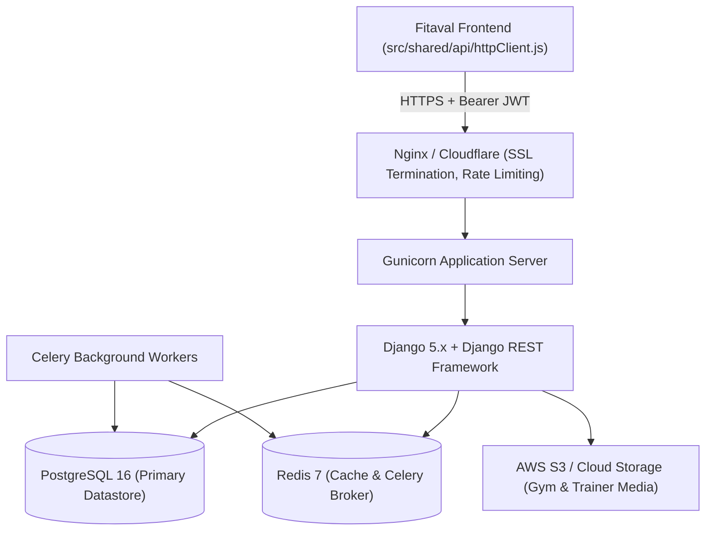
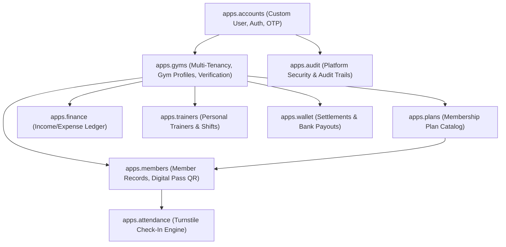
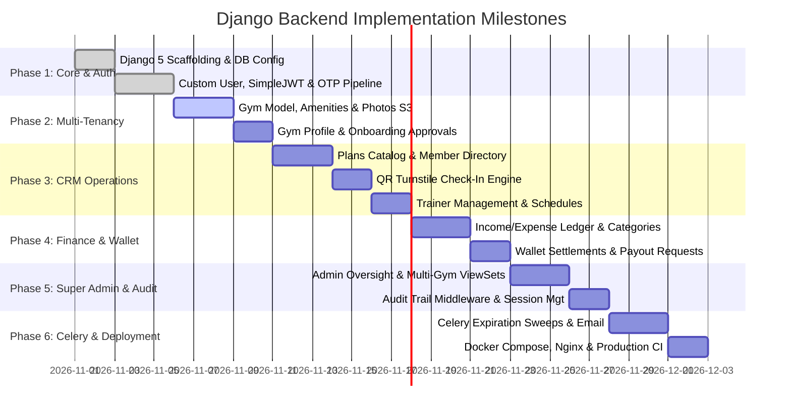

# Fitaval — Django Backend Implementation Plan & Architecture Blueprint

> **Enterprise Backend Roadmap:** Comprehensive architecture, Django apps breakdown, model specifications, endpoint-to-client mapping, multi-tenant scoping, and phased implementation order for the Fitaval Django REST Framework (DRF) backend.

---

## 1. Architectural Foundations & Technology Stack

The Fitaval backend is designed as a stateless, multi-tenant REST API serving both the Gym Owner CRM and the Super Admin Panel.



### Core Backend Dependencies
* **Python**: `3.12+`
* **Django**: `5.1.x`
* **REST Framework**: `djangorestframework == 3.15.x`
* **JWT Authentication**: `djangorestframework-simplejwt == 5.3.x`
* **Database Driver**: `psycopg[binary] == 3.2.x`
* **CORS Management**: `django-cors-headers == 4.4.x`
* **Filter Framework**: `django-filter == 24.x`
* **Background Processing**: `celery == 5.4.x` + `redis == 5.0.x`
* **Cloud Storage**: `django-storages[boto3] == 1.14.x`
* **API Documentation**: `drf-spectacular == 0.27.x` (OpenAPI 3.0 schema generation)

---

## 2. Django Apps Architecture & Model Specifications

The backend is partitioned into 9 domain-driven Django applications:



---

### 2.1 `apps.accounts` — User Identity & Authentication

Manages system credentials, role claims, OTP verification, and JWT lifecycles.

#### Models
* **`User` (`AbstractBaseUser`, `PermissionsMixin`)**:
  * `id`: `UUIDField` (primary key, default `uuid.uuid4`).
  * `email`: `EmailField` (unique, indexed, normalized username).
  * `full_name`: `CharField(max_length=255)`.
  * `role`: `CharField(choices=['crm', 'admin', 'super_admin'], default='crm')`.
  * `gym`: `ForeignKey('gyms.Gym', null=True, blank=True, on_delete=SET_NULL)`.
  * `is_active`: `BooleanField(default=True)`.
  * `is_staff`: `BooleanField(default=False)`.
  * `created_at`: `DateTimeField(auto_now_add=True)`.
* **`EmailOTP`**:
  * `email`: `EmailField(indexed)`.
  * `otp_code`: `CharField(max_length=6)`.
  * `purpose`: `CharField(choices=['signup', 'login', 'reset'])`.
  * `expires_at`: `DateTimeField()`.
  * `is_used`: `BooleanField(default=False)`.
* **`PasswordResetToken`**:
  * `user`: `ForeignKey(User, on_delete=CASCADE)`.
  * `token`: `UUIDField(default=uuid.uuid4, unique=True)`.
  * `created_at`: `DateTimeField(auto_now_add=True)`.
  * `expires_at`: `DateTimeField()`.

#### Custom JWT Claims (`CustomTokenObtainPairSerializer`)
In order for the frontend (`src/portal/session.js`) to route cleanly without round-trip lookups, custom claims are embedded in access tokens:
```python
token['role'] = user.role
token['gym_id'] = user.gym.id if user.gym else None
token['email'] = user.email
token['name'] = user.full_name
```

---

### 2.2 `apps.gyms` — Multi-Tenancy & Gym Profile Management

The root multi-tenant anchor. All CRM records foreign-key into `Gym`.

#### Models
* **`Gym`**:
  * `id`: `CharField(max_length=32, primary_key=True)` (e.g. `GYM-KCH-001`).
  * `name`: `CharField(max_length=255)`.
  * `tagline`: `CharField(max_length=255, blank=True)`.
  * `status`: `CharField(choices=['pending', 'approved', 'rejected', 'suspended'], default='pending')`.
  * `verified`: `BooleanField(default=False)` (Super Admin "Blue Tick" toggle).
  * `phone`: `CharField(max_length=32)`.
  * `email`: `EmailField()`.
  * `website`: `URLField(blank=True)`.
  * `address`: `TextField()`.
  * `city`: `CharField(max_length=100)`.
  * `state`: `CharField(max_length=100)`.
  * `pin_code`: `CharField(max_length=20)`.
  * `latitude`: `DecimalField(max_digits=9, decimal_places=6, null=True)`.
  * `longitude`: `DecimalField(max_digits=9, decimal_places=6, null=True)`.
  * `created_at`: `DateTimeField(auto_now_add=True)`.
* **`GymAmenity`**:
  * `gym`: `ForeignKey(Gym, related_name='amenities', on_delete=CASCADE)`.
  * `amenity_code`: `CharField(max_length=64)` (`sauna`, `showers`, `parking`, etc.).
* **`GymPhoto`**:
  * `gym`: `ForeignKey(Gym, related_name='photos', on_delete=CASCADE)`.
  * `image`: `ImageField(upload_to='gyms/photos/%Y/%m/')`.
  * `caption`: `CharField(max_length=255, blank=True)`.
* **`GymOperatingHours`**:
  * `gym`: `ForeignKey(Gym, related_name='operating_hours', on_delete=CASCADE)`.
  * `day_of_week`: `SmallIntegerField(choices=DAYS_OF_WEEK)`.
  * `is_open`: `BooleanField(default=True)`.
  * `open_time`: `TimeField(null=True)`.
  * `close_time`: `TimeField(null=True)`.

---

### 2.3 `apps.members` — Member Directory & Digital QR Passes

#### Models
* **`Member`**:
  * `id`: `CharField(max_length=32, primary_key=True)` (e.g. `MBR-0042`).
  * `gym`: `ForeignKey('gyms.Gym', on_delete=CASCADE)`.
  * `name`: `CharField(max_length=255)`.
  * `phone`: `CharField(max_length=32)`.
  * `email`: `EmailField(blank=True)`.
  * `gender`: `CharField(max_length=32, blank=True)`.
  * `emergency_contact`: `CharField(max_length=32, blank=True)`.
  * `address`: `TextField(blank=True)`.
  * `notes`: `TextField(blank=True)`.
  * `current_plan`: `ForeignKey('plans.MembershipPlan', null=True, on_delete=SET_NULL)`.
  * `start_date`: `DateField()`.
  * `renewal_date`: `DateField()`.
  * `status`: `CharField(choices=['Active', 'Expired', 'Frozen'], default='Active')`.
  * `qr_token`: `UUIDField(default=uuid.uuid4, unique=True, indexed=True)`.
  * `created_at`: `DateTimeField(auto_now_add=True)`.

---

### 2.4 `apps.plans` — Membership Plan Catalog

#### Models
* **`MembershipPlan`**:
  * `id`: `CharField(max_length=32, primary_key=True)` (e.g. `PLN-01`).
  * `gym`: `ForeignKey('gyms.Gym', on_delete=CASCADE)`.
  * `name`: `CharField(max_length=128)` (e.g. "Annual VIP Gold").
  * `price`: `DecimalField(max_digits=10, decimal_places=2)`.
  * `duration_months`: `PositiveSmallIntegerField(default=1)`.
  * `description`: `TextField(blank=True)`.
  * `features`: `JSONField(default=list)` (list of perk strings).
  * `is_active`: `BooleanField(default=True)`.

---

### 2.5 `apps.attendance` — Check-In & Turnstile Integration

#### Models
* **`AttendanceRecord`**:
  * `gym`: `ForeignKey('gyms.Gym', on_delete=CASCADE)`.
  * `member`: `ForeignKey('members.Member', on_delete=CASCADE)`.
  * `check_in_time`: `DateTimeField(auto_now_add=True)`.
  * `check_out_time`: `DateTimeField(null=True, blank=True)`.
  * `method`: `CharField(choices=['qr_scan', 'manual', 'turnstile_relay'], default='qr_scan')`.

---

### 2.6 `apps.finance` & `apps.wallet` — Ledger & B2C Settlements

#### Models
* **`Transaction`**:
  * `gym`: `ForeignKey('gyms.Gym', on_delete=CASCADE)`.
  * `type`: `CharField(choices=['income', 'expense'])`.
  * `category`: `CharField(max_length=64)`.
  * `amount`: `DecimalField(max_digits=12, decimal_places=2)`.
  * `date`: `DateField()`.
  * `payment_method`: `CharField(max_length=64)`.
  * `description`: `TextField(blank=True)`.
  * `member`: `ForeignKey('members.Member', null=True, blank=True, on_delete=SET_NULL)`.
* **`Wallet`**:
  * `gym`: `OneToOneField('gyms.Gym', related_name='wallet', on_delete=CASCADE)`.
  * `available_balance`: `DecimalField(max_digits=12, decimal_places=2, default=0.00)`.
  * `pending_balance`: `DecimalField(max_digits=12, decimal_places=2, default=0.00)`.
* **`PayoutRequest`**:
  * `wallet`: `ForeignKey(Wallet, related_name='payouts', on_delete=CASCADE)`.
  * `amount`: `DecimalField(max_digits=12, decimal_places=2)`.
  * `bank_account_number`: `CharField(max_length=32)`.
  * `ifsc_code`: `CharField(max_length=16)`.
  * `account_holder_name`: `CharField(max_length=255)`.
  * `status`: `CharField(choices=['pending', 'approved', 'completed', 'rejected'], default='pending')`.
  * `utr_reference`: `CharField(max_length=64, blank=True)`.
  * `requested_at`: `DateTimeField(auto_now_add=True)`.

---

### 2.7 `apps.trainers` — Personal Coaches & Shifts

#### Models
* **`Trainer`**:
  * `gym`: `ForeignKey('gyms.Gym', on_delete=CASCADE)`.
  * `name`: `CharField(max_length=255)`.
  * `specialty`: `CharField(max_length=128)`.
  * `experience_years`: `PositiveSmallIntegerField(default=1)`.
  * `phone`: `CharField(max_length=32)`.
  * `email`: `EmailField()`.
  * `bio`: `TextField(blank=True)`.
  * `certifications`: `JSONField(default=list)`.
  * `photo`: `ImageField(upload_to='trainers/photos/%Y/%m/', null=True, blank=True)`.
* **`TrainerSchedule`**:
  * `trainer`: `ForeignKey(Trainer, related_name='schedules', on_delete=CASCADE)`.
  * `day_of_week`: `SmallIntegerField()`.
  * `start_time`: `TimeField()`.
  * `end_time`: `TimeField()`.

---

### 2.8 `apps.audit` — Platform Audit Log

#### Models
* **`AuditLog`**:
  * `actor`: `ForeignKey('accounts.User', null=True, on_delete=SET_NULL)`.
  * `action`: `CharField(max_length=128)` (e.g. `gym.approve`, `qr.rotate`, `user.freeze`).
  * `target_model`: `CharField(max_length=64)`.
  * `target_object_id`: `CharField(max_length=64)`.
  * `before_state`: `JSONField(null=True, blank=True)`.
  * `after_state`: `JSONField(null=True, blank=True)`.
  * `ip_address`: `GenericIPAddressField(null=True)`.
  * `timestamp`: `DateTimeField(auto_now_add=True)`.

---

## 3. Frontend-to-Backend 1:1 API Route Mapping

All endpoints listed below match the calls initiated by `src/portal/session.js`, `src/crm/api/client.js`, and `src/admin/api/client.js`.

### 3.1 Authentication & Portal Endpoints (`/api/v1/auth/`)

| Frontend Call | Method | Backend URL Path | Django View / ViewSet | Description |
|---|---|---|---|---|
| `login(email, pass)` | `POST` | `/api/v1/auth/login/` | `CustomTokenObtainPairView` | Exchanges credentials for access & refresh JWTs |
| `signUp(email, pass)` | `POST` | `/api/v1/auth/register/` | `RegisterInitiateView` | Creates pending user, dispatches 6-digit OTP |
| `verifySignUp(code)` | `POST` | `/api/v1/auth/verify-otp/` | `VerifyOTPView` | Validates OTP and activates gym owner user |
| `httpClient` 401 retry | `POST` | `/api/v1/auth/token/refresh/`| `TokenRefreshView` | SimpleJWT standard token rotation |
| `logout()` | `POST` | `/api/v1/auth/logout/` | `LogoutView` | Blacklists refresh token |
| `ForgotPassword.jsx` | `POST` | `/api/v1/auth/password/reset/` | `PasswordResetRequestView` | Generates reset token & sends email link |
| `ResetPassword.jsx` | `POST` | `/api/v1/auth/password/reset/confirm/` | `PasswordResetConfirmView`| Sets new password using validated token |
| `client.auth.me()` | `GET` | `/api/v1/auth/me/` | `CurrentUserView` | Returns active user profile |

---

### 3.2 CRM Endpoints (`/api/v1/crm/`)

All CRM endpoints automatically scope queries to `request.user.gym_id`.

| Frontend API Module | Method | Backend URL Path | Django ViewSet | Key Operations |
|---|---|---|---|---|
| `client.entities.Member` | `GET`, `POST` | `/api/v1/crm/members/` | `MemberViewSet` | List, search, status filter, enroll member |
| `client.entities.Member` | `GET`, `PATCH`, `DELETE`| `/api/v1/crm/members/{id}/` | `MemberViewSet` | Member detail, edit, cancel |
| `client.entities.MemberCheckin`| `POST` | `/api/v1/crm/attendance/check-in/`| `AttendanceViewSet` | QR token validation & turnstile pulse |
| `client.entities.Attendance` | `GET` | `/api/v1/crm/attendance/` | `AttendanceViewSet` | Attendance logs, daily footfall |
| `client.entities.Plan` | `GET`, `POST` | `/api/v1/crm/plans/` | `PlanViewSet` | List plans, create new tier |
| `client.entities.Plan` | `PATCH`, `DELETE` | `/api/v1/crm/plans/{id}/` | `PlanViewSet` | Toggle active status, edit pricing |
| `client.entities.Trainer` | `GET`, `POST` | `/api/v1/crm/trainers/` | `TrainerViewSet` | Trainer roster, add trainer |
| `client.entities.Trainer` | `PATCH`, `DELETE` | `/api/v1/crm/trainers/{id}/` | `TrainerViewSet` | Update schedules, certifications |
| `client.entities.Transaction` | `GET`, `POST` | `/api/v1/crm/transactions/` | `TransactionViewSet` | Financial ledger, add income/expense |
| `client.entities.GymProfile` | `GET`, `PATCH` | `/api/v1/crm/gym-profile/` | `GymProfileView` | Business profile, GPS, hours, amenities |
| `client.entities.WalletTransaction`| `GET` | `/api/v1/crm/wallet/transactions/`| `WalletViewSet` | Ledger of online member receipts |
| `client.entities.Subscription` | `GET` | `/api/v1/crm/subscription/` | `SubscriptionView` | Current Fitaval SaaS tier and invoices |
| `UploadPublicFile` | `POST` | `/api/v1/crm/upload/` | `FileUploadView` | S3 image upload returning clean URL |

---

### 3.3 Super Admin Endpoints (`/api/v1/admin/`)

Enforces `permissions.IsSuperAdmin` on all operations.

| Frontend Module | Method | Backend URL Path | Django ViewSet | Description |
|---|---|---|---|---|
| `adminClient.gyms.list` | `GET` | `/api/v1/admin/gyms/` | `AdminGymViewSet` | Multi-gym directory, status filter |
| `adminClient.gyms.get` | `GET` | `/api/v1/admin/gyms/{id}/` | `AdminGymViewSet` | Complete gym detail with all sub-tabs |
| `adminClient.gyms.verify` | `POST` | `/api/v1/admin/gyms/{id}/verify/`| `AdminGymViewSet` | Toggle blue-tick verified badge |
| `adminClient.approvals.review` | `POST` | `/api/v1/admin/approvals/{id}/review/`| `ApprovalViewSet` | Approve / Reject gym onboarding |
| `adminClient.users.list` | `GET` | `/api/v1/admin/users/` | `AdminUserViewSet` | Cross-gym member directory |
| `adminClient.users.rotateQr` | `POST` | `/api/v1/admin/users/{id}/rotate-qr/`| `AdminUserViewSet` | Invalidate & reissue member QR token |
| `adminClient.finance.getOverview`| `GET` | `/api/v1/admin/finance/overview/` | `AdminFinanceView` | Platform gross receipts & commissions |
| `adminClient.wallet.settle` | `POST` | `/api/v1/admin/wallet/settle/` | `AdminWalletView` | Process bank transfer payout for gym |
| `adminClient.audit.list` | `GET` | `/api/v1/admin/audit/` | `AuditLogViewSet` | Immutable platform security trail |

---

## 4. Multi-Tenant Scoping & Security Enforcement

### 4.1 Gym-Scoped ViewSet Base Class
To prevent cross-tenant data leakage, all CRM viewsets inherit from `TenantScopedModelViewSet`:

```python
class TenantScopedModelViewSet(viewsets.ModelViewSet):
    """
    Guarantees that CRM endpoints can only read or mutate records
    belonging to the authenticated user's gym.
    """
    permission_classes = [permissions.IsAuthenticated, IsGymStaff]

    def get_queryset(self):
        user = self.request.user
        return self.queryset.filter(gym=user.gym)

    def perform_create(self, serializer):
        serializer.save(gym=self.request.user.gym)
```

### 4.2 Turnstile Check-In Rate Limiting
The check-in endpoint (`POST /crm/attendance/check-in/`) is rate-limited via Redis to prevent brute-force QR code replay:
* Limit: `60 requests / minute / branch IP`.

---

## 5. Phased Implementation Order & Milestones



### Milestone Deliverables

#### Phase 1: Scaffolding, Custom User & Authentication
1. Initialize Django 5 project with settings split (`base.py`, `development.py`, `production.py`).
2. Implement custom `User` model, migrations, and `accounts` app.
3. Wire SimpleJWT with custom claims (`gym_id`, `role`, `name`).
4. Implement OTP dispatch and verification endpoints (`POST /auth/register/`, `POST /auth/verify-otp/`).
5. Wire password reset email pipeline (`POST /auth/password/reset/`).

#### Phase 2: Multi-Tenancy & Gym Profile
1. Implement `Gym`, `GymPhoto`, `GymAmenity`, and `GymOperatingHours` models.
2. Build `TenantScopedModelViewSet` base class.
3. Implement `GET/PATCH /crm/gym-profile/` supporting multi-file S3 photo upload.

#### Phase 3: Plans, Members & QR Check-In Engine
1. Implement `MembershipPlan` and `Member` models.
2. Build member CRUD with Excel-compatible filtering and QR token generation.
3. Build `POST /crm/attendance/check-in/` with membership status evaluation (checks start and renewal dates before returning 200 OK vs 403 Expired).
4. Build `Trainer` and weekly schedule models.

#### Phase 4: Financial Ledger & Settlement Wallet
1. Implement `Transaction` model supporting `income` and `expense` types.
2. Implement `Wallet` and `PayoutRequest` models.
3. Build monthly analytics endpoints for dashboard charts (`Recharts` compatibility).

#### Phase 5: Super Admin Console & Audit Trails
1. Implement `IsSuperAdmin` permission class.
2. Build multi-gym registry views with blue-tick verification endpoint (`POST /admin/gyms/{id}/verify/`).
3. Build gym application review and approval workflow.
4. Implement `AuditLog` middleware capturing request IP and before/after JSON states on sensitive models.

#### Phase 6: Celery Workers & Production Hardening
1. Schedule daily Celery beat job:
   - Scans members where `renewal_date < today()` and updates status to `Expired`.
   - Sends notification reminders 7 days prior to expiration.
2. Configure Dockerfile and `docker-compose.yml` (Django, Postgres, Redis, Celery).
3. Set up production security headers (HSTS, SSL redirect, CORS origins).

---

*© 2026 Fitaval. All rights reserved.*

