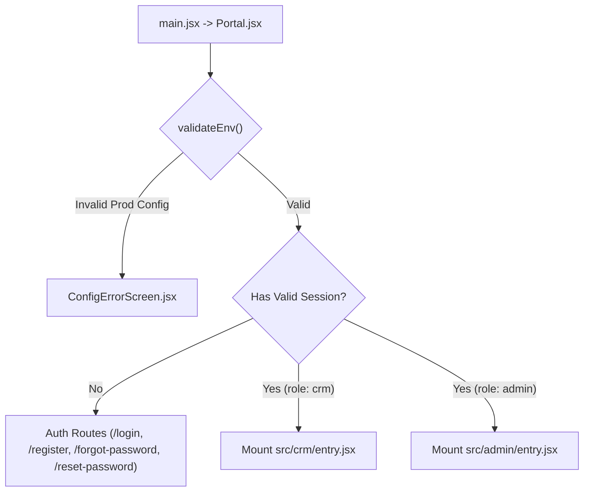
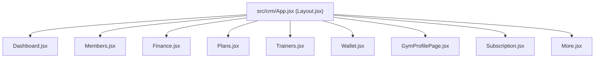
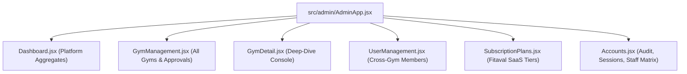

# Fitaval — Frontend Modules, Forms & UI Requirements Analysis

> **Comprehensive UI Inventory:** Detailed technical audit of all React components, forms, validation rules, input fields, state providers, and third-party integrations across the Portal, CRM, and Super Admin applications.

---

## 1. Technical Stack & Dependency Ecosystem

The Fitaval frontend is built on a modern, decoupled single-page application (SPA) architecture:

| Category | Technology / Library | Version | Purpose in Application |
|---|---|---|---|
| **Core Framework** | React + React DOM | `^18.2.0` | Component hierarchy, virtual DOM, lazy-loaded chunk mounting |
| **Build Tooling** | Vite | `^8.2.0` | Lightning-fast development server, HMR, Rolldown production bundler |
| **Routing** | React Router DOM | `^6.26.0` | Client-side routing, nested layouts, URL search query management |
| **Server State** | `@tanstack/react-query` | `^5.84.1` | Asynchronous entity caching, background refetching, mutation states |
| **Form Management** | `react-hook-form` + `zod` | `^7.54.2` / `^3.24.2` | Schema-driven form validation, controlled inputs, error states |
| **UI Primitives** | Radix UI (`@radix-ui/*`) | `latest` | Headless accessible components (Dialog, Tabs, Select, Dropdown, Tooltip) |
| **Icons & Visuals** | `lucide-react` | `^0.475.0` | Comprehensive vector icon library across CRM and Admin |
| **Charts & Analytics**| `recharts` | `^2.15.4` | Responsive SVG area charts, bar graphs, and revenue trends |
| **Camera & QR** | `@zxing/browser` + `@zxing/library` | `^0.2.1` / `^0.23.0` | Video stream capture and barcode decoding for turnstile check-in |
| **QR Generation** | `qrcode-generator` | `^1.4.4` | Generates SVG/Canvas QR codes for digital member access passes |
| **File Generation** | `exceljs` + `jspdf` + `html2canvas` | `^4.4.0` / `^4.2.1` / `^1.4.1` | Client-side Excel spreadsheets and printable PDF membership passes |
| **Date Arithmetic** | `date-fns` | `^3.6.0` | Date formatting, difference calculation, calendar month intervals |
| **Payments** | `@stripe/stripe-js` + `@stripe/react-stripe-js`| `^5.2.0` / `^3.0.0` | Embedded Stripe Elements for SaaS subscription upgrades |

---

## 2. Shared Portal Module (`src/portal`)

The Portal provides the unified entry point, routing between CRM and Admin while securing unauthenticated boundaries.

### 2.1 Component & Form Specifications

#### 1. Login Component (`Login.jsx`)
* **Route**: `/login`
* **Form Action**: Submits credentials to `POST /auth/login/` via `login(email, password)`.
* **Fields**:

| Field Name | Type | Required | Validation Rule | UI Control |
|---|---|---|---|---|
| `email` | `string` | Yes | Valid email format (`you@gym.com`) | Native `<input type="email">` |
| `password` | `string` | Yes | Min 1 character | `PasswordField` with show/hide eye toggle |

* **Post-Submit Logic**:
  * Extracts JWT access and refresh tokens via `tokenManager`.
  * Inspects `role` claim: if `crm` redirects to `/`; if `admin` redirects to `/admin`.
  * Honors safe `?returnTo=` query parameter if present and same-origin.

#### 2. Registration Component (`Register.jsx`)
* **Route**: `/register`
* **Two-Step Onboarding Flow**:
  1. *Step 1 (Form Submission)*: Submits club details to `POST /auth/register/`.
  2. *Step 2 (OTP Verification)*: Dispatches 6-digit verification code to `POST /auth/verify-otp/`.
* **Fields**:

| Step | Field Name | Type | Required | Validation Rule |
|---|---|---|---|---|
| **Step 1** | `gymName` | `string` | Yes | Minimum 2 characters |
| **Step 1** | `ownerName` | `string` | Yes | Full name required |
| **Step 1** | `email` | `string` | Yes | Valid email regex (`\S+@\S+\.\S+`) |
| **Step 1** | `password` | `string` | Yes | Minimum 6 characters |
| **Step 1** | `confirm` | `string` | Yes | Must match `password` |
| **Step 2** | `code` | `string` | Yes | Exactly 6 numeric digits (`/^\d{6}$/`) |

#### 3. Password Recovery Components
* **`ForgotPassword.jsx` (`/forgot-password`)**:
  * Field: `email` (`string`, required).
  * Submits to `POST /auth/password/reset/`. Shows affirmative status message upon completion.
* **`ResetPassword.jsx` (`/reset-password`)**:
  * URL Param: `?token=<reset_jwt_token>`.
  * Fields: `newPassword` (min 6 chars), `confirmPassword` (equality check).
  * Submits to `POST /auth/password/reset/confirm/`.

---

## 3. Gym Management CRM Module (`src/crm`)

The CRM manages day-to-day operations for fitness clubs. All data mutations are automatically scoped to the logged-in owner's `gym_id`.

### 3.1 Detailed Screen & Form Inventory

#### 1. Members Management (`src/crm/pages/Members.jsx`)
* **Key Features**: Live search query, filter tabs (`All`, `Active`, `Expired`, `Frozen`), member profile drawer, QR code digital pass, and Excel export.
* **Add / Edit Member Modal Form**:

| Field Name | Data Type | Required | Form Element | Validation / Options |
|---|---|---|---|---|
| `name` | `string` | Yes | Text Input | Full legal name, min 2 chars |
| `phone` | `string` | Yes | Tel Input | 10-digit mobile or international format |
| `email` | `string` | Yes | Email Input | Valid email address |
| `plan` | `string` | Yes | Select Dropdown | Populated from active gym plans (`Plans.jsx`) |
| `start_date` | `date` | Yes | Date Input | ISO format `YYYY-MM-DD` |
| `status` | `enum` | Yes | Select Dropdown | `Active`, `Expired`, `Frozen` |
| `gender` | `enum` | No | Select Dropdown | `Male`, `Female`, `Other`, `Prefer not to say` |
| `emergency_contact`| `string` | No | Tel Input | Secondary contact phone number |
| `address` | `string` | No | Textarea | Residential address |
| `notes` | `string` | No | Textarea | Medical disclosures, trainer preferences |

* **Export Implementation (`src/crm/utils/exportExcel.js`)**:
  * Uses `exceljs` to generate formatted `.xlsx` workbooks containing Member ID, Name, Phone, Email, Current Plan, Renewal Date, and Status.

#### 2. QR Scanner Turnstile Dialog (`src/crm/components/QrScannerDialog.jsx`)
* **Camera Streaming**: Uses `navigator.mediaDevices.getUserMedia` wrapped by `@zxing/browser`.
* **Scan Processing Flow**:
  1. Detects continuous video frames via `ZXing.BrowserQRCodeReader`.
  2. Parses digital payload (e.g. `FTV-MBR-KCH-0042`).
  3. Sends verification request to `POST /crm/attendance/check-in`.
  4. On success: renders green access badge, logs check-in timestamp, and plays affirmative chime.
  5. On failure: renders red warning banner (e.g., `Membership Expired: 12 days ago`).

#### 3. Financial Ledger (`src/crm/pages/Finance.jsx`)
* **Visuals**: Recharts area chart showing 30-day cumulative cash flow, net profit summary, income vs expense breakdowns.
* **Add Transaction Modal Form**:

| Field Name | Data Type | Required | Input Control | Options / Rules |
|---|---|---|---|---|
| `type` | `enum` | Yes | Radio / Toggle Group | `income` or `expense` |
| `category` | `string` | Yes | Select Dropdown | *Income*: Membership, Personal Training, Day Pass, Retail, Cafe *Expense*: Trainer Salaries, Equipment, Maintenance, Rent, Utilities |
| `amount` | `number` | Yes | Numeric Input | Positive integer/decimal (`> 0`) |
| `date` | `date` | Yes | Date Input | Default to `today` |
| `payment_method` | `enum` | Yes | Select Dropdown | `Cash`, `UPI / GPay`, `Credit Card`, `Debit Card`, `Bank Transfer` |
| `member_id` | `string` | No | Searchable Select | Optional link to specific registered member |
| `description` | `string` | No | Text Input | Narrative memorandum |

#### 4. Membership Plans (`src/crm/pages/Plans.jsx`)
* **Display**: Multi-tier grid cards highlighting duration, pricing, member count, and active toggles.
* **Add / Edit Plan Modal Form**:

| Field Name | Data Type | Required | Validation Rules | Description |
|---|---|---|---|---|
| `name` | `string` | Yes | Min 3 characters | E.g., "Gold Annual VIP", "Monthly Basic" |
| `price` | `number` | Yes | Numeric (`>= 0`) | Amount charged in local currency (INR / USD) |
| `duration_months`| `number`| Yes | Range `1` to `36` | Plan validity period |
| `description` | `string` | No | Text Input | Summary marketing subtitle |
| `features` | `string[]`| Yes | Dynamic Tag List | Included privileges (e.g., "Full Gym Access", "1 PT Session") |
| `is_active` | `boolean`| Yes | Switch Toggle | Whether available for new member enrollments |

#### 5. Trainers & Staff (`src/crm/pages/Trainers.jsx`)
* **Add / Edit Trainer Modal Form**:

| Field Name | Data Type | Required | Input Control |
|---|---|---|---|
| `name` | `string` | Yes | Text Input |
| `specialty` | `string` | Yes | Text Input (e.g., "CrossFit / Hypertrophy") |
| `experience_years`| `number` | Yes | Number Input (e.g., `5`) |
| `phone` | `string` | Yes | Tel Input |
| `email` | `string` | Yes | Email Input |
| `bio` | `string` | No | Textarea |
| `certifications`| `string[]` | No | Comma-separated tag pill input |
| `photo` | `file` | No | File upload with live image preview |

* **Weekly Schedule Picker (`WeeklyScheduleEditor.jsx`)**:
  * Configures per-day shifts (`Mon` through `Sun`) with `openTime` and `closeTime` using `CircularTimePickerModal.jsx`.
* **Staff Attendance Log (`StaffAttendance.jsx`)**:
  * Interactive month calendar marking trainer check-in and check-out timestamps.

#### 6. Gym Profile Manager (`src/crm/pages/GymProfilePage.jsx`)
* **Sections**:
  1. *Branding*: Club Name, Tagline, Logo URL, Contact Phone, Support Email, Website.
  2. *Geographic Location*: Street Address, City, State, PIN Code, GPS Latitude/Longitude (interactive pinpointing via `GymLocationPicker.jsx`).
  3. *Operating Hours*: Weekday and Weekend shifts (`OperatingHoursManager.jsx`).
  4. *Amenities Checklist*: 10 configurable amenities (`Locker Rooms`, `Sauna`, `Steam Bath`, `Showers`, `Cardio Zone`, `CrossFit Rig`, `Free Wi-Fi`, `Air Conditioning`, `Parking`, `Cafeteria`).
  5. *Photo Gallery*: Multi-image uploader displaying club interior and equipment photos.

#### 7. Digital Settlement Wallet (`src/crm/pages/Wallet.jsx`)
* **Displays**: Available Balance, Pending Settlements, Lifetime Payouts.
* **Request Payout Modal Form**:

| Field Name | Type | Required | Notes |
|---|---|---|---|
| `amount` | `number` | Yes | Must be `<= available_balance` and `>= min_withdrawal_amount` |
| `bank_account_number` | `string` | Yes | 9-18 digit account number |
| `ifsc_code` | `string` | Yes | 11-character Indian Financial System Code regex (`^[A-Z]{4}0[A-Z0-9]{6}$`) |
| `account_holder_name`| `string` | Yes | Legal name on bank records |

---

## 4. Super Admin Module (`src/admin`)

The Super Admin console supervises the entire platform across all fitness brands.

### 4.1 Component & Action Specifications

#### 1. Platform Dashboard (`src/admin/pages/dashboard/Dashboard.jsx`)
* **KPI Metrics**: Total Partner Gyms, Active Multi-Branch Members, Platform ARR, Aggregate Daily Footfall.
* **Approvals Carousel**: Pending gym applications awaiting document verification.
* **Branch Occupancy Meters**: Live radial gauge indicators showing current capacity percentages.

#### 2. Gym Management & Approvals (`src/admin/pages/gyms/GymManagement.jsx`)
* **DataTable**: Displays Gym ID, Brand Name, City, Registered Date, Verification Status, Action Dropdown.
* **Review Gym Application Modal**:
  * Displays business registration documents, owner ID proofs, and gym photos.
  * Actions: `Approve Gym` (dispatches onboarding email) or `Reject Application` (prompts for feedback reason).
* **Blue-Tick Verification**:
  * Toggles `verified` flag on the partner gym profile (`src/shared/verified.js`).

#### 3. Gym Detail Console (`src/admin/pages/gyms/detail/GymDetail.jsx`)
A comprehensive tabbed inspector:
* **Overview Tab (`OverviewTab.jsx`)**: Complete facility audit, operating hours, ratings, and amenity checklist.
* **Staff Tab (`GymPeopleTabs.jsx`)**: Full roster of branch managers and receptionists.
* **Trainers Tab**: On-site coaches and active client assignments.
* **Members Tab**: Branch members with one-click emergency QR token reissuance (`RotateQrModal`).
* **Reviews Tab (`GymReviewsTab.jsx`)**: Moderation queue to remove abusive or fraudulent gym reviews.
* **Finance Tab (`GymFinanceTab.jsx`)**: Gross receipts, gym payout shares, platform commission deductions.
* **Wallet Tab (`GymWalletTab.jsx`)**: Payout approval modal with bank transaction UTR tracking.

#### 4. Cross-Gym User Directory (`src/admin/pages/users/UserManagement.jsx`)
* Searchable table of all fitness members registered across all partner gyms.
* Actions:
  * `Rotate QR Pass`: Invalidates old turnstile token and issues a fresh digital pass immediately.
  * `Freeze Membership`: Temporarily halts access privileges.

#### 5. Security & Platform Audit (`src/admin/pages/account/Accounts.jsx`)
* **Audit Trail (`AuditTab.jsx`)**: Immutable table logging `timestamp`, `actor_email`, `action_verb`, `target_model`, `object_id`, and `ip_address`.
* **Session Manager (`SessionsTab.jsx`)**: Active JWT sessions with one-click remote revocation.
* **Staff Matrix (`StaffTab.jsx`)**: Configures role permissions (`super`, `manager`, `desk`, `trainer`) across feature flags:
  * `edit_gym`, `revenue`, `members`, `export_members`, `freeze_users`, `approve_gyms`, `view_audit`.

---

## 5. Global UI Components & Design System Primitives

Both applications leverage a shared set of accessible UI primitives:

1. **`CircularTimePickerModal.jsx`**: Custom analog clock face picker allowing intuitive drag-and-click selection of hours and minutes for gym operating schedules.
2. **`NotificationsDrawer.jsx`**: Slide-out drawer tracking unread operational alerts (membership expirations, payment receipts, check-in errors).
3. **`UserNotRegisteredError.jsx`**: User-friendly fallback screen shown when authenticated credentials exist but no associated gym profile has been provisioned.
4. **`EnterNav` Handler (`enterNav.js`)**: Keyboard accessibility utility attached to forms enabling fluid field navigation via the `Enter` key.

---

*© 2026 Fitaval. All rights reserved.*

