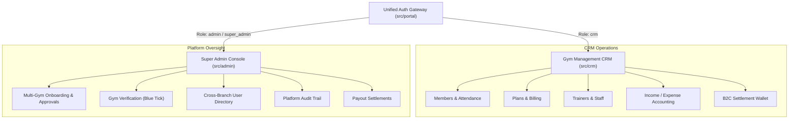
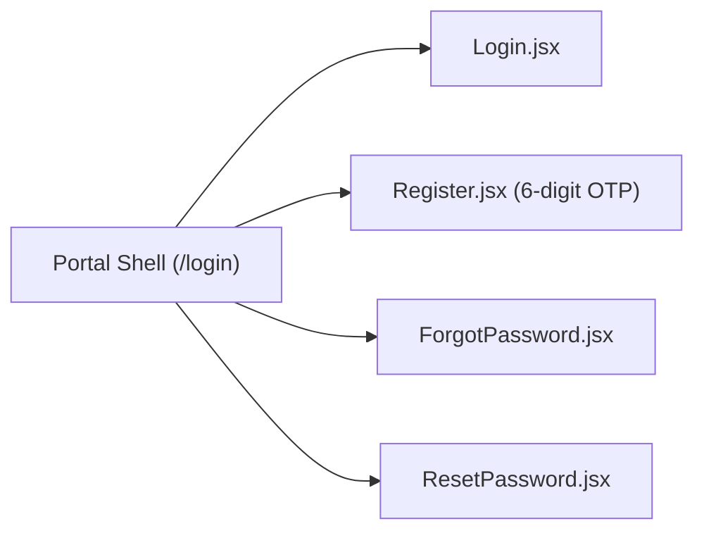

# Fitaval — Project Overview & Architecture Blueprint

> **One program, one unified authentication gateway, three dedicated client surfaces.**  
> Fitaval is an enterprise-grade fitness club management platform combining a gym owner CRM, a multi-tenant platform super-admin console, and a shared authentication gateway into a cohesive single-page application (SPA) powered by React 18, Vite, and Tailwind CSS.

---

## 1. Executive Summary & Vision

Fitaval eliminates the fragmentation common in fitness technology by unifying operations across three core operational surfaces:



### Core Design Principles
1. **Zero Style Collision**: The CRM and Super Admin panel feature completely separate design tokens, color palettes, and typography. Each app uses its own Tailwind configuration (`tailwind.crm.config.js` vs `tailwind.admin.config.js`) and dedicated root stylesheet (`src/crm/index.css` vs `src/admin/index.css`).
2. **On-Demand Lazy Loading**: Using `React.lazy()` dynamic chunking, users only download the bundle associated with their authenticated role. A gym owner never loads super-admin code, and a super-admin never loads CRM components.
3. **Fail-Closed Security**: In production builds (`VITE_APP_ENV=production`), mock fixtures and demo bypasses are permanently stripped. Environment variables are strictly validated at bootstrap, halting startup if API configurations point to localhost or are missing.
4. **Resilient Centralized Networking**: All network communication flows through a unified HTTP client (`src/shared/api/httpClient.js`) with in-memory access tokens, 401 token refresh concurrency mutexes, and request timeouts.

---

## 2. The Three Client Applications

### 2.1 The Authentication Portal (`src/portal`)

The front door of the application. Evaluates user credentials, handles self-onboarding, and dynamically mounts the appropriate workspace.



* **Served Path**: `/login`, `/register`, `/forgot-password`, `/reset-password`
* **Target Users**: Unauthenticated visitors, gym owners registering new clubs, staff logging in, platform super-admins.
* **Key Capabilities**:
  * **Unified Role Dispatch**: Accepts credentials, inspects backend token response role claim (`crm` vs `admin`), and routes to `/` or `/admin`.
  * **Self-Service Gym Onboarding**: Multi-step registration collecting club name, owner info, password, and verifying email via 6-digit OTP.
  * **Password Recovery**: Asynchronous email link dispatch (`/auth/password/reset/`) and token-based password reset (`/auth/password/reset/confirm/`).
  * **Reactive Session Listener**: Listens to `tokenManager.onAuthChange` across tabs; automatically redirects to `/login` when a session is invalidated or token refresh fails.
  * **Production Guard Display**: Displays an isolated `ConfigErrorScreen` if environment settings fail security validation in production.

---

### 2.2 Gym Management CRM (`src/crm`)

A feature-complete business management dashboard for gym owners, club managers, front desk staff, and personal trainers.

* **Served Path**: `/` (with sub-routes `/members`, `/finance`, `/plans`, `/trainers`, `/wallet`, `/subscription`, `/gym-profile`, `/settings`)
* **Target Users**: Gym Owners, Branch Managers, Front Desk Receptionists, Personal Trainers.
* **Layout & Navigation**: Responsive sidebar with collapsible toggle (`Layout.jsx`), mobile bottom navigation bar, quick-search shortcut, and notifications drawer.
* **Key Modules**:
  * **Executive Dashboard (`Dashboard.jsx`)**: Real-time KPI cards (active members, expiring soon, today's footfall, monthly revenue), 7-day revenue trend chart, today's transaction feed, and quick check-in actions.
  * **Member Management (`Members.jsx`)**: Full member registry with live search, status filters (`Active`, `Expired`, `Frozen`), Add/Edit modal, membership assignment, digital QR card generation, and client-side Excel export.
  * **Turnstile Check-In Scanner (`QrScannerDialog.jsx`)**: Hardware/camera-driven QR scanner utilizing `@zxing/browser` to validate member passes and trigger physical turnstile relays.
  * **Financial Ledger (`Finance.jsx`)**: Double-entry income and expense tracker with category tagging (Memberships, Personal Training, Maintenance, Utilities, Rent) and interactive monthly charts.
  * **Membership Plans (`Plans.jsx`)**: Custom plan catalog (e.g., Monthly, Quarterly, Annual, VIP) with pricing, duration, facility privileges, and active toggles.
  * **Trainer Directory & Scheduling (`Trainers.jsx`)**: Personal trainer profiles, specialties, certifications, active client assignments, weekly schedule pickers, and daily staff attendance logs.
  * **Digital Settlement Wallet (`Wallet.jsx`)**: Tracks B2C online payments, platform processing fees, available settlement balances, and bank withdrawal requests.
  * **Gym Brand Profile (`GymProfilePage.jsx`)**: Club branding, GPS coordinate picker, operating hours schedule (weekday/weekend), amenities list, and photo gallery manager.
  * **Software Subscription (`Subscription.jsx`)**: Manages the gym's SaaS tier with Fitaval, payment methods, and invoice history.

---

### 2.3 Super Admin Platform Console (`src/admin`)

The centralized multi-tenant management portal used by Fitaval platform staff to supervise all onboarded gyms, approve new applications, audit security events, and manage financial payouts.

* **Served Path**: `/admin`
* **Target Users**: Super Admins, Compliance Reviewers, Support Leads, Platform Financial Controllers.
* **Styling & Feel**: Dark aesthetic, emerald green highlights, high-density data tables, Geist typography.
* **Key Modules**:
  * **Platform Overview (`Dashboard.jsx`)**: Aggregate platform metrics (total gyms, total members, platform ARR, average branch occupancy), active gym floor alerts, and live global check-in feed.
  * **Gym Management & Verification (`GymManagement.jsx`)**: Multi-gym registry with approval status (`Approved`, `Pending`, `Rejected`), blue-tick verification badge toggles, and document review drawer.
  * **Gym Deep-Dive Console (`GymDetail.jsx`)**: Tabbed inspector for individual gym branches:
    1. *Overview Tab*: Club branding, shift hours, facilities, uploaded photos.
    2. *Staff Tab*: On-site personnel directory and active shifts.
    3. *Trainers Tab*: Certified coaches and active rosters.
    4. *Members Tab*: Branch-specific member list with emergency QR token rotation.
    5. *Reviews Tab*: Moderation queue for member ratings and reviews.
    6. *Finance Tab*: Gross revenue breakdown and platform commission cuts.
    7. *Wallet Tab*: B2C settlement approvals and direct bank transfer triggers.
  * **Cross-Gym User Directory (`UserManagement.jsx`)**: Platform-wide search across all gym members, account status freezing, and multi-branch privilege auditing.
  * **SaaS Tier Catalog (`SubscriptionPlans.jsx`)**: Fitaval platform subscription plans offered to gym owners (Basic, Pro, Enterprise).
  * **Platform Security & Audit (`Accounts.jsx`)**: Immutable audit logs (`AuditTab.jsx`), active user sessions (`SessionsTab.jsx`), staff roles and permission matrix (`StaffTab.jsx`), and security settings.

---

## 3. High-Level Technical Architecture

```mermaid
graph TD
    subgraph Client Layer
        Browser["User Browser (Desktop / Mobile)"]
    end

    subgraph Frontend Build (Vite + React 18)
        Router["Portal Router (src/portal/Portal.jsx)"]
        Env["Environment Guard (src/config/env.js)"]
        Token["Token Manager (In-Memory + SessionStorage)"]
        HTTP["HTTP Client (src/shared/api/httpClient.js)"]
        
        Router --> Env
        Router --> Token
        Token --> HTTP
    end

    subgraph Backend API (Django REST Framework)
        DRF["DRF API Gateway (/api/v1/)"]
        AuthApp["Auth & Accounts (SimpleJWT)"]
        GymApp["Gym Multi-Tenancy"]
        MemberApp["Members & Attendance"]
        FinanceApp["Finance & Wallet"]
        AuditApp["Audit Logging"]
        
        DRF --> AuthApp
        DRF --> GymApp
        DRF --> MemberApp
        DRF --> FinanceApp
        DRF --> AuditApp
    end

    subgraph Database & Services
        PG[("PostgreSQL 16")]
        Redis[("Redis (Cache & Queues)")]
        Celery["Celery Task Workers"]
        S3["AWS S3 / Media CDN"]
    end

    Browser --> Router
    HTTP -->|"HTTPS Bearer JWT"| DRF
    AuthApp --> PG
    GymApp --> PG
    MemberApp --> PG
    FinanceApp --> PG
    AuditApp --> PG
    DRF --> Redis
    Celery --> PG
    Celery --> Redis
    GymApp --> S3
```

---

## 4. Security & State Lifecycle Summary

| Security Boundary | Implementation Detail | Primary File |
|---|---|---|
| **Access Token Storage** | Stored strictly in runtime memory variables to prevent malicious browser scripts from extracting tokens via `localStorage`. | `src/shared/auth/tokenManager.js` |
| **Session Isolation** | Non-sensitive session descriptors (`email`, `role`, `name`) live in `sessionStorage` (scoped to browser tab). | `src/portal/session.js` |
| **Silent 401 Refresh** | On token expiration, `httpClient` queues incoming requests via a promise mutex, calls `/auth/token/refresh/`, and replays requests without user interruption. | `src/shared/api/httpClient.js` |
| **Fail-Closed Gate** | Production builds automatically disallow mock mode (`USE_MOCK = false`) and require a valid, non-localhost `VITE_API_BASE_URL`. | `src/config/env.js` |
| **Route Protection** | Route guards in `CrmApp` and `AdminApp` reject unauthenticated navigation and immediately bounce users to `/login`. | `src/crm/App.jsx`, `src/admin/AdminApp.jsx` |
| **Hardware Scanner** | Scans digital QR tokens containing cryptographic member IDs; queries backend before opening physical turnstiles. | `src/crm/components/QrScannerDialog.jsx` |

---

*© 2026 Fitaval. All rights reserved.*

