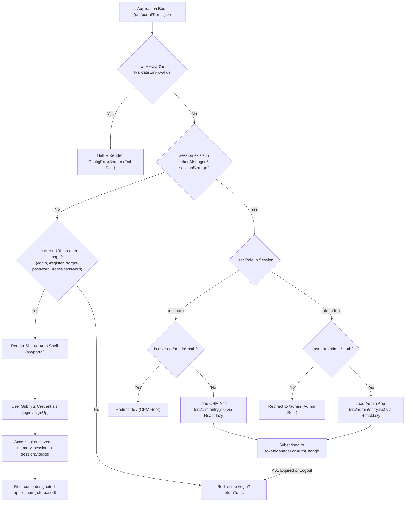
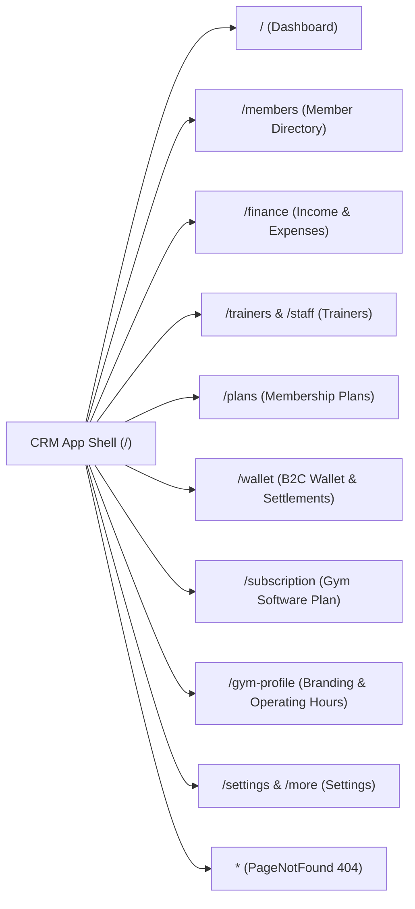
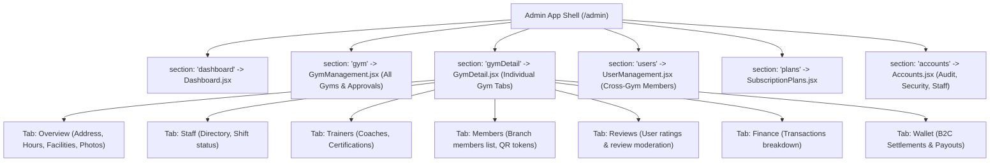
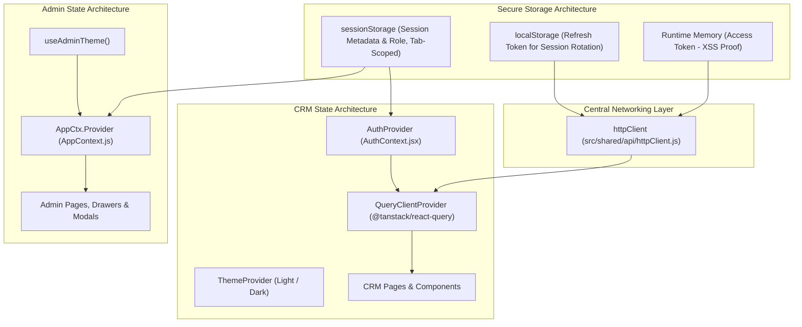
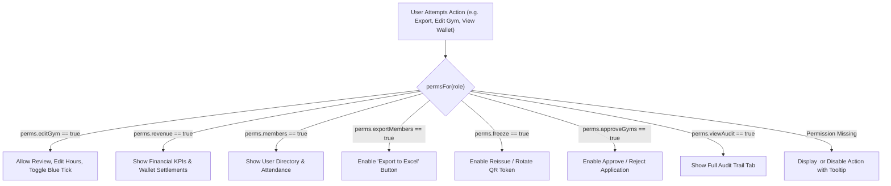
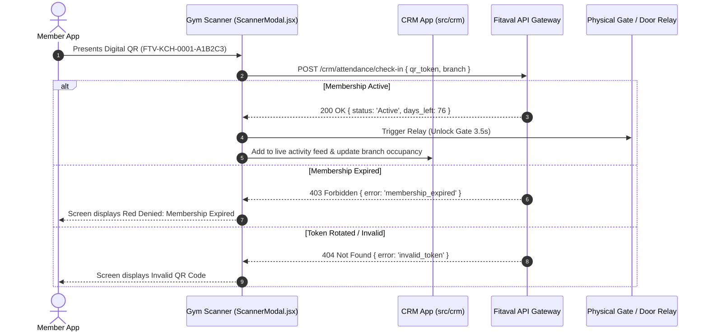

# Fitaval — State & Routing Architecture

> **The Navigation & Data Flowchart:** Complete architectural blueprint mapping client-side routes, role-based gateways, React context providers, and data flow pipelines across Fitaval.

---

## 1. Top-Level Routing & Role Gateway Flowchart

Fitaval implements an intelligent front door (`src/portal/Portal.jsx`) where one unified authentication boundary serves two independent applications. Startup verification validates the environment, followed by role-based routing and reactive session listening.

---

## 2. Client-Side Route Definitions

### 2.1 Shared Portal Routes (`src/portal`)

| Route | Component | Description |
|---|---|---|
| `/login` | `Login.jsx` | Shared login form supporting both Gym Owners and Super Admins |
| `/register` | `Register.jsx` | Gym owner self-onboarding flow with 6-digit verification code |
| `/forgot-password` | `ForgotPassword.jsx` | Password reset request with backend email dispatch |
| `/reset-password` | `ResetPassword.jsx` | Token-validated password change form |

---

### 2.2 CRM Client Routes (`src/crm/App.jsx`)

Driven by `react-router-dom` (v6) wrapped in `Layout.jsx` with responsive sidebar and bottom navigation. Protected by route guards redirecting unauthenticated requests to `/login`:

| Route Path | Page Component | Core Data Entities Used |
|---|---|---|
| `/` | `Dashboard.jsx` | `Member`, `Transaction`, `MembershipPlan`, `WalletTransaction` |
| `/members` | `Members.jsx` | `Member` (CRUD, status filter, QR generation, Excel export) |
| `/finance` | `Finance.jsx` | `Transaction` (Income/Expense categorizations, monthly summaries) |
| `/trainers` | `Trainers.jsx` | `Trainer` (Biographies, certifications, client rosters) |
| `/plans` | `Plans.jsx` | `MembershipPlan` (Pricing, duration, benefits, active toggles) |
| `/wallet` | `Wallet.jsx` | `WalletTransaction` (Available balance, withdrawal requests) |
| `/subscription` | `Subscription.jsx`| Software tier subscription, invoicing, billing methods |
| `/gym-profile` | `GymProfilePage.jsx`| Business details, GPS coordinates, facilities, photo gallery |
| `/settings` | `More.jsx` | Notification preferences, theme toggle, account credentials |

---

### 2.3 Super Admin Section Navigation (`src/admin/AdminApp.jsx`)

The Admin Panel operates on a fast in-app section switcher with deep-linking capability via browser history and session verification:

---

## 3. State Management & Context Providers

Fitaval separates state into four clear layers:
1. **Application Session & In-Memory Token Manager** (`src/shared/auth/tokenManager.js` & `src/portal/session.js`)
2. **CRM Authentication & User Context** (`src/crm/lib/AuthContext.jsx`)
3. **Super Admin Platform Context** (`src/admin/context/AppContext.js`)
4. **Server Entity Cache** (`@tanstack/react-query`)

---

## 4. Role-Based Feature Gating Architecture

In the Admin Panel, features are gated by the user's role permissions matrix:

---

## 5. Data Flow: Member Check-In & Turnstile Integration

